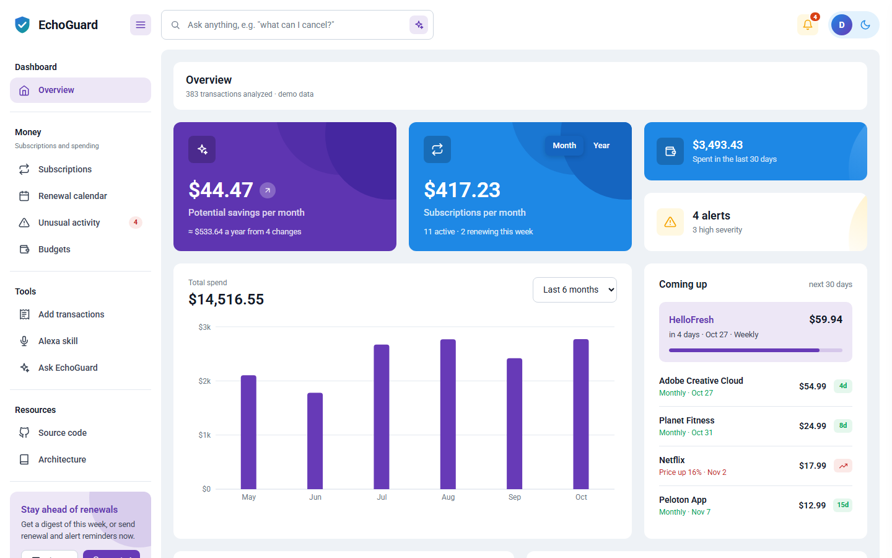
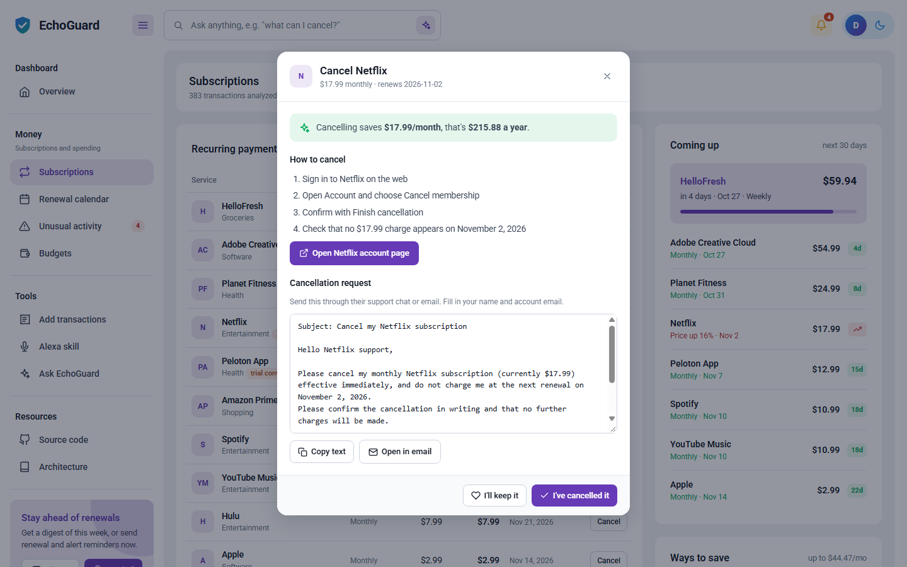
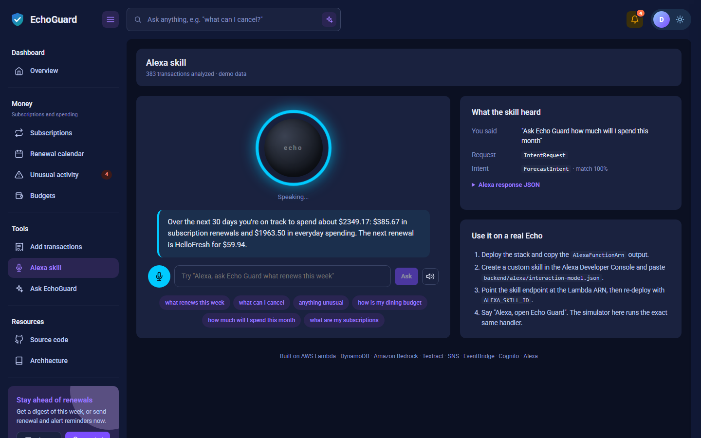
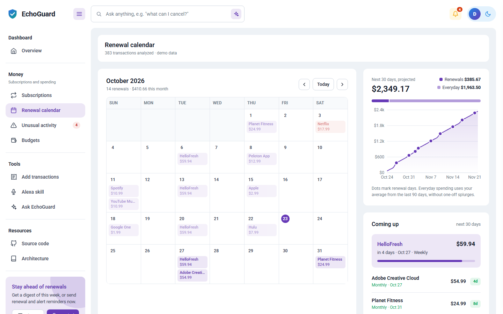
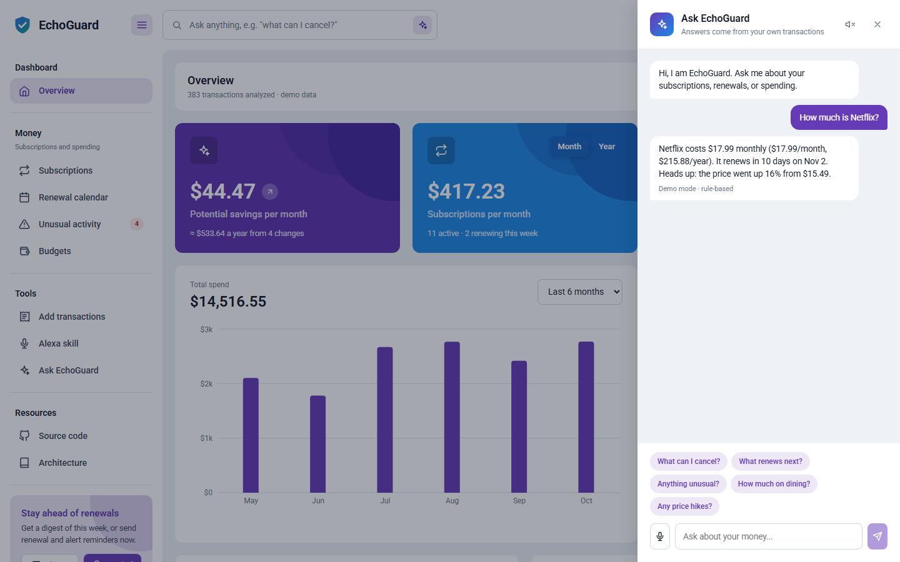

# EchoGuard 🛡️

**Your AI guard against forgotten subscriptions, sneaky price hikes and surprise charges.**

EchoGuard reads your transactions, finds every recurring payment, flags anything unusual, tells you exactly what to cancel (and helps you do it), and answers questions by chat, voice, or Alexa.

Built for the Amazon developer hackathon on AWS Lambda, DynamoDB, EventBridge, SNS, Cognito, CloudFront and the Alexa Skills Kit, with optional Amazon Bedrock and Textract.



## Try it in 30 seconds

```bash
npm install
npm run dev      # API on :4000, web on :5173
```

Open http://localhost:5173. It runs fully offline with realistic demo data: no AWS account, no API keys, no cost.

Things to try:

- **Search bar:** "What can I cancel?", "How much is Netflix?", "How do I cancel Hulu?", "How much will I spend this month?"
- **Subscriptions → Cancel** on any service: steps, a direct link, and a ready-to-send cancellation request
- **Alexa skill** page: click the mic and say *"Alexa, ask Echo Guard what renews this week"* (Chrome or Edge)
- **Unusual activity:** mark the DoorDash double charge as "Not a duplicate" and watch the alert count drop
- **Renewal calendar:** every upcoming charge on a month grid

The demo data rolls forward with the calendar, so renewals are always upcoming and "this week" alerts are always this week.

## What it does

| Feature | How |
|---|---|
| Subscription auto-discovery | Groups transactions by normalized merchant and matches weekly / monthly / yearly cadences |
| Price hike alerts | Flags a recurring charge that changed amount (Netflix $15.49 → $17.99) |
| Free trial conversions | Detects a $0 first charge followed by a paid one |
| Cancelled subscription detection | A recurring charge that stopped renewing |
| Duplicate charge detection | Same merchant and amount within 10 minutes, even with other charges in between |
| Spending anomalies | Z-score outliers per category, large first-time merchants, weekly category spikes |
| Savings suggestions | Overlapping services (Spotify + YouTube Music), price hikes, converted trials |
| **Cancel assistant** | Per-service steps, the account page link, and a cancellation request to copy or email |
| **Keep / cancelled marks** | Mark a service as kept (never suggested again) or cancelled (drops out of totals) |
| **"Not suspicious" feedback** | Dismiss a false alarm and EchoGuard stops flagging it |
| **30-day cash forecast** | Scheduled renewals plus your everyday spending rate, with renewal days marked |
| **Renewal calendar** | Month grid of every projected charge |
| Natural language Q&A | Built-in assistant over your own data; optionally Claude on Amazon Bedrock |
| **Voice** | Speak questions and hear answers (browser Web Speech API) |
| **Alexa skill + in-browser simulator** | "Alexa, ask Echo Guard what renews this week"; the simulator runs the exact skill handler |
| Budget guardrails | Per-category monthly budgets with 80% warning, over-budget and pace-to-exceed alerts |
| Renewal reminders | Daily EventBridge job publishes per-user alerts to SNS 3 days before renewals |
| Weekly digest | Summary of costs, renewals, alerts and the best savings tip |
| Receipts & imports | Paste receipt text or import any bank CSV; Textract photo scanning and Plaid bank sync are optional |
| Sign-in | Cognito Hosted UI with PKCE; the API's JWT authorizer scopes data per user |

| Cancel assistant | Alexa simulator |
|---|---|
|  |  |
| **Renewal calendar** | **Ask EchoGuard** |
|  |  |

## Cost: free by default

Everything EchoGuard needs fits in the AWS free tier for a hackathon-sized deployment (Lambda, DynamoDB on-demand, HTTP API, CloudFront, S3, Cognito, SNS email, EventBridge). The services that bill per use are **off unless you turn them on**:

| Optional service | What it adds | Turn on with |
|---|---|---|
| Amazon Bedrock (Claude Haiku 5.5) | Free-form LLM answers and digest | `ENABLE_BEDROCK=true` (and enable model access in the Bedrock console) |
| Amazon Textract | Receipt photo scanning | `ENABLE_TEXTRACT=true` |
| Plaid + a KMS key | Live bank sync (sandbox is free; the KMS key is about $1/month) | `PLAID_CLIENT_ID`, `PLAID_SECRET` |

Without them, the built-in assistant answers from your data, receipts are parsed from pasted text, and transactions come from CSV import.

## Deploy to AWS

Prereqs: AWS CLI and SAM CLI, with credentials configured (`aws configure`).

```bash
ENABLE_AUTH=false ALERT_EMAIL=you@example.com ./infra/deploy.sh
```

This creates the DynamoDB table, SNS topic, Cognito user pool and hosted UI, the HTTP API and Lambda, the scheduled reminder Lambda, the Alexa Lambda, and a private S3 bucket behind CloudFront (HTTPS). It then seeds the demo data and uploads the built frontend. The first deploy takes a few extra minutes while CloudFront provisions. Confirm the SNS email subscription to receive alerts.

| Variable | Effect |
|---|---|
| `ENABLE_AUTH=false` | Skip sign-in; the app opens straight to the demo user (best for judging) |
| `ALERT_EMAIL` | Subscribe an email to the demo user's reminders and alerts |
| `ENABLE_BEDROCK`, `ENABLE_TEXTRACT` | Opt into the paid services above |
| `PLAID_CLIENT_ID`, `PLAID_SECRET`, `PLAID_ENV` | Turn on "Link bank" (sandbox login: user_good / pass_good) |
| `FRONTEND_ORIGIN` | Extra allowed Cognito redirect origin, e.g. a custom domain |
| `ALEXA_SKILL_ID` | Only this Alexa skill may invoke the Alexa Lambda (set once the skill exists, then re-run) |

With sign-in on, each user's email is subscribed to their own alerts on first use (an SNS filter policy on `userId`). To connect a real Echo, follow [backend/alexa/README.md](backend/alexa/README.md).

## Project layout

```
backend/
  src/handlers/api.js          route handlers (framework-agnostic)
  src/handlers/lambda.js       API Gateway, EventBridge and Alexa entry points
  src/local-server.js          Express wrapper for local dev
  src/services/
    subscriptionDetector.js    recurring-payment detection
    anomalyDetector.js         unusual-spend detection
    insights.js                savings suggestions
    forecast.js                30-day cash-out forecast
    cancelGuide.js             per-service cancellation help
    prefs.js                   keep / cancelled marks, dismissed alerts
    analysis.js                combines everything for one user
    ai.js                      built-in assistant, optional Bedrock
    alexa.js                   Alexa intent handler and in-browser simulator
    budgets.js, receipts.js, categorize.js, importers.js, plaid.js, notify.js, db.js
    demoData.js                synthetic demo data that rolls forward with the date
  alexa/interaction-model.json Alexa skill model
  tests/                       node:test suite
frontend/                      React + Vite dashboard (recharts)
infra/template.yaml            SAM template
infra/deploy.sh                one-shot deploy
docs/ARCHITECTURE.md           architecture and data model
```

## API

All routes take an `X-User-Id` header (defaults to `demo`); with Cognito in front, the JWT `sub` claim is used instead.

```
GET  /health
GET  /dashboard                       everything: summary, subscriptions, anomalies, tips, forecast, charts
GET  /subscriptions | /anomalies | /insights | /forecast
GET  /subscriptions/:id/cancel-guide  steps, link and cancellation request
PUT  /subscriptions/:id/status        { status: "keep" | "cancelled" | null }
POST /anomalies/:id/dismiss           mark as not suspicious
POST /anomalies/restore               bring dismissed alerts back
GET  /transactions?limit=50&category=Dining
POST /transactions                    single object or array: { merchant, amount, date, category? }
DELETE /transactions/:id
POST /transactions/import             { csv }
POST /receipts                        { text } or { imageBase64 } (Textract), optional save: true
POST /chat                            { question }
GET  /digest
POST /reminders/run                   trigger the reminder job now
GET  /budgets   PUT /budgets          { Dining: 600, ... }
POST /plaid/link-token | /plaid/exchange | /plaid/sync
POST /alexa                           raw Alexa request JSON
POST /alexa/simulate                  { utterance } -> intent + the skill's spoken response
```

## Tests

```bash
npm test
```

## License

[MIT](LICENSE)
